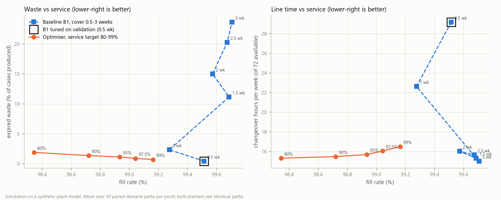
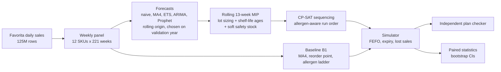
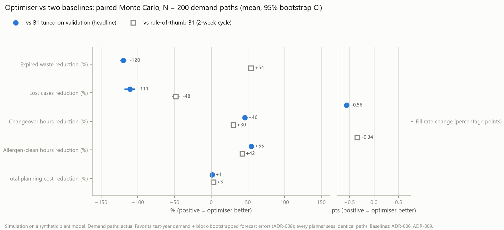

# Shelf-Life-Aware Production Planner

Weekly production planning for 12 perishable SKUs on one refrigerated line: forecast demand, then let a
mixed-integer program (OR-Tools) choose quantities, run order and safety stock under line capacity, allergen
cleaning rules and shelf-life limits. Every number below is a **simulation on a synthetic plant model** driven by
real retail demand (Corporacion Favorita, Kaggle). Nothing here is a claim of real-plant savings.



## 1. Problem
A perishable-food plant is squeezed three ways. Make too much and product expires before it can ship with enough
remaining life. Make too little and orders go unfilled. Switch products too often and the line loses hours to
changeovers, including wet cleans whenever a product with an allergen (milk, egg, sesame, ...) is followed by one
that does not declare it. A spreadsheet planner usually applies one cover rule to every SKU and a fixed run order.
This project asks how much a shelf-life-aware optimiser changes waste, service and changeover time, compared with a
competent baseline (B1), and under which conditions the advantage disappears.

**Answer in one paragraph.** Against a baseline whose one setting was tuned the same way as the optimiser's, the
optimiser does *not* cut waste. It frees about half of the changeover and allergen-clean hours, at slightly lower
total planning cost, and gives up a little waste and service. It wins on waste and line time together only against
the untuned rule-of-thumb planner, or when shelf lives are short. Against long changeovers it is the only planner
that keeps service up. Details and CIs below. Getting to this answer took two fixes to the baseline (ADR-009,
ADR-010), both documented.

## 2. Method

- **Data:** Favorita chain-wide sales for 12 perishable items (dairy, deli, prepared foods), aggregated to weeks and
  scaled to plant cases (calibrated to about 85% line utilisation). The panel ends in March 2017 because of a product
  relaunch (ADR-005). Train 117 weeks, validation year (all model and planner choices), test year (reporting only).
- **Plant (synthetic, documented):** 72 h/week, sequence-dependent changeovers built from FDA Big 9 allergen sets,
  shelf lives of 14-56 days, minimum 50% remaining shelf life at shipment, min/max run lengths
  ([docs/assumptions.md](docs/assumptions.md)).
- **Forecasting:** rolling-origin backtest, refit every week; per-SKU model chosen on validation WAPE
  ([docs/methods/forecasting.md](docs/methods/forecasting.md)).
- **Baseline B1:** a good-practice (s, S) planner: 4-week moving average, reorder point, cover, allergen ladder,
  run-out-priority capacity repair ([docs/methods/baseline.md](docs/methods/baseline.md)). Headline version: cover
  tuned on the validation year with the optimiser's own tuning rule (ADR-009). The rule-of-thumb version (two-week
  cycle) is reported alongside.
- **Optimiser:** 13-week rolling MIP with inventory tracked by age (expired = unshipped stock past the shippable
  age), soft safety stock from forecast error, then CP-SAT run order with the true changeover matrix
  ([docs/methods/optimization.md](docs/methods/optimization.md)). Planner settings were chosen on the validation
  year after a failed first test run (ADR-007).
- **Evaluation:** (A) replay of the real test year; (B) Monte Carlo with 200 demand paths (actual demand plus
  block-bootstrapped forecast errors, identical for every planner), with paired bootstrap CIs; (C) one-at-a-time
  sensitivity (29 cells) and a waste / line-time vs service frontier ([docs/methods/experiments.md](docs/methods/experiments.md)). Every
  executed plan is re-validated by a checker that does not import the optimiser.

## 3. Results
<!-- RESULTS:START -->
| KPI, optimiser vs baseline | Monte Carlo vs B1 tuned on validation (cover 0.5 wk), N = 200 | Monte Carlo vs rule-of-thumb B1 (2-week cycle), N = 200 | Historical replay, test year, same baseline |
|---|---|---|---|
| Expired waste | 119.8% higher (95% CI 115.6 to 124.2) | 54.2% lower (95% CI 53.5 to 55.0) | 100.7% higher |
| Lost cases | 110.8% higher (95% CI 103.9 to 118.1) | 48.1% higher (95% CI 43.2 to 53.3) | 117.8% higher |
| Fill rate | -0.56 (95% CI -0.58 to -0.53) pts | -0.34 (95% CI -0.37 to -0.32) pts | -0.39 pts |
| Changeover hours | 46.0% lower (95% CI 45.8 to 46.1) | 30.2% lower (95% CI 29.9 to 30.5) | 48.2% lower |
| Allergen-clean hours | 54.8% lower (95% CI 54.6 to 55.0) | 42.3% lower (95% CI 42.0 to 42.6) | - |
| Total planning cost (model weights) | 1.4% lower (95% CI 1.3 to 1.4) | 3.0% lower (95% CI 3.0 to 3.1) | 2.1% lower |

Levels (Monte Carlo means): **optimiser** fill 98.9%, expired 1.11% of production, 15.7 changeover h/week, line utilisation 73%; **tuned B1** fill 99.5%, expired 0.50% of production, 29.1 changeover h/week, line utilisation 91%; **rule-of-thumb B1** fill 99.3%, expired 2.37% of production, 22.5 changeover h/week, line utilisation 83%.

Forecast accuracy, test year (WAPE): selected model 11.50% vs 4-week moving average 11.48% (relative change -0.2 (95% CI -5.4 to +4.5)%: no detectable gain); vs seasonal naive 17.60%: 34.7% lower (95% CI 30.8 to 38.3).

Sensitivity (29 one-at-a-time cells, N = 50 each, vs tuned B1): planning cost lower with CI above zero in 100% of cells (range 0.2% lower to 11.1% lower); changeover hours lower in 100%; expired waste lower in 17%.

Independent plan checker: 0 violations; solver fallbacks: 0 weeks. Run `main_33e3602840`, seed 20261118. *All figures: simulation on a synthetic plant model.*
<!-- RESULTS:END -->

What the numbers say, the charter targets met and missed, and where it does not help:
[docs/results/summary.md](docs/results/summary.md) and
[docs/results/sensitivity_findings.md](docs/results/sensitivity_findings.md). Paired differences vs both baselines:


## 4. How to run
```
python -m venv .venv && .venv\Scripts\activate          # macOS/Linux: source .venv/bin/activate
pip install -r requirements.txt -r requirements-dev.txt   # add -r requirements-optional.txt (Prophet) to rebuild results
pytest -q && ruff check .
streamlit run app/streamlit_app.py                      # dashboard: works on a fresh clone, no data needed
```
Rebuilding the results needs the Favorita data (your own Kaggle account; the terms forbid redistribution):
`python scripts/download_data.py`, then `python scripts/run_all.py --quick` (about 30 min, checks the committed
decisions and headline numbers) or `python scripts/run_all.py` (full rebuild, several hours).
Dashboard guide: [docs/app_guide.md](docs/app_guide.md). The dashboard is not hosted: run it locally.
Windows: Prophet bundles CmdStan with very long file paths, so clone to a short path (e.g. `C:\src\`) or enable
long paths, or the optional install fails with "No such file or directory".

## 5. Key assumptions (full register: [docs/assumptions.md](docs/assumptions.md))
1. Retail chain sales stand in for a manufacturer's distribution-centre demand (A-01).
2. One filling line is the only bottleneck, 72 h/week (A-07, A-08).
3. Changeover times: 0.5 h base, +0.5 h routine clean, +3.0 h allergen wet clean (A-09 to A-11; swept x0.5-x2).
4. Allergen clean needed when the previous product has an allergen the next does not declare (A-06).
5. Shelf lives 14-56 days, cross-checked with USDA FoodKeeper where comparable (A-15; swept -50% to +25%).
6. Minimum 50% remaining shelf life at shipment (A-02; swept 30-70%).
7. Unmet demand is lost, and unshippable stock is written off (A-05, A-18).
8. Objective weights (production, holding, expiry, lost sale, changeover hour) are relative assumptions, never
   reported as money (A-25; swept).

## 6. Limitations (each with its likely direction of bias)
1. **Synthetic plant.** Rates, cleaning times, costs and shelf lives are assumptions. *Direction: unknown in sign;
   the sensitivity grid shows how far the result moves.*
2. **Retail demand as a plant-demand proxy.** Store sales are smoother and more seasonal than DC orders, which are
   lumpier. *Direction: likely flatters both planners; lumpier orders would raise waste and lost sales for both.*
3. **Weekly buckets.** Production in a week is assumed shippable that week and ages in whole weeks. *Direction:
   coarse ages overstate waste for 14-day products, which inflates the room for improvement.*
4. **Single line, no OEE losses or breakdowns.** *Direction: favours the tuned B1, which runs the line at about
   91% utilisation against the optimiser's 73%, so it has the least slack to absorb downtime.*
5. **Monte Carlo forecasts are not refit to each simulated path.** *Direction: slightly favours B1, whose moving
   average sees each path (ADR-008).*
6. **Validation-year error model under-covers the test year** (80% intervals cover 72%). *Direction: safety stock
   protects less than its target; the fill-rate gap is partly this, and the frontier shows the cost of more buffer.*
7. **Point-forecast MIP.** The planner hedges uncertainty only through safety stock and a deliberately optimistic
   changeover estimate (ADR-007); a stochastic model would be the principled fix. *Direction: understates what
   optimisation could achieve.*
8. **Forecasting adds nothing measurable here.** The selected models do not beat a 4-week moving average on the test
   year, so the gains come from planning logic. *Direction: neutral; it is a finding, reported as such.*
9. **Spare line hours have no value in the model** beyond the changeover cost weight. *Direction: understates the
   optimiser where freed capacity can be sold or absorbs downtime; neutral otherwise.*

## Data sources and licences
- Corporacion Favorita Grocery Sales Forecasting (Kaggle competition data, used under its rules; not redistributed;
  `data/raw` and derived weekly files are git-ignored).
- USDA FSIS FoodKeeper (CC0), archived copy, used only as a shelf-life cross-check
  ([docs/research/foodkeeper_crosscheck.md](docs/research/foodkeeper_crosscheck.md)).

## Repository map
`src/shelflife/{data,plant,forecast,sim,opt,checks,analysis}` library | `scripts/` pipeline CLIs (`run_all.py`) |
`configs/` every parameter with source and range | `results/` outputs (`headline_numbers.json` is the single source
of reported numbers) | `app/` Streamlit dashboard | `docs/` methods, decisions (ADR-001..011), results |
`tests/` pytest suite | `backlog/` plan and tickets (`python tools/backlog.py list`).
