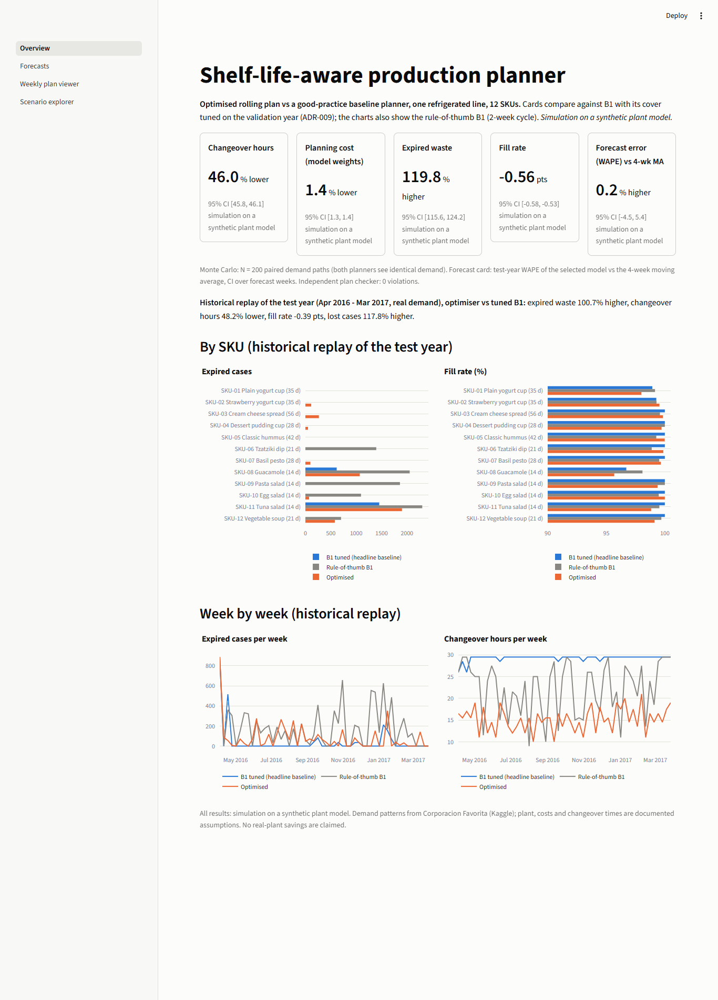
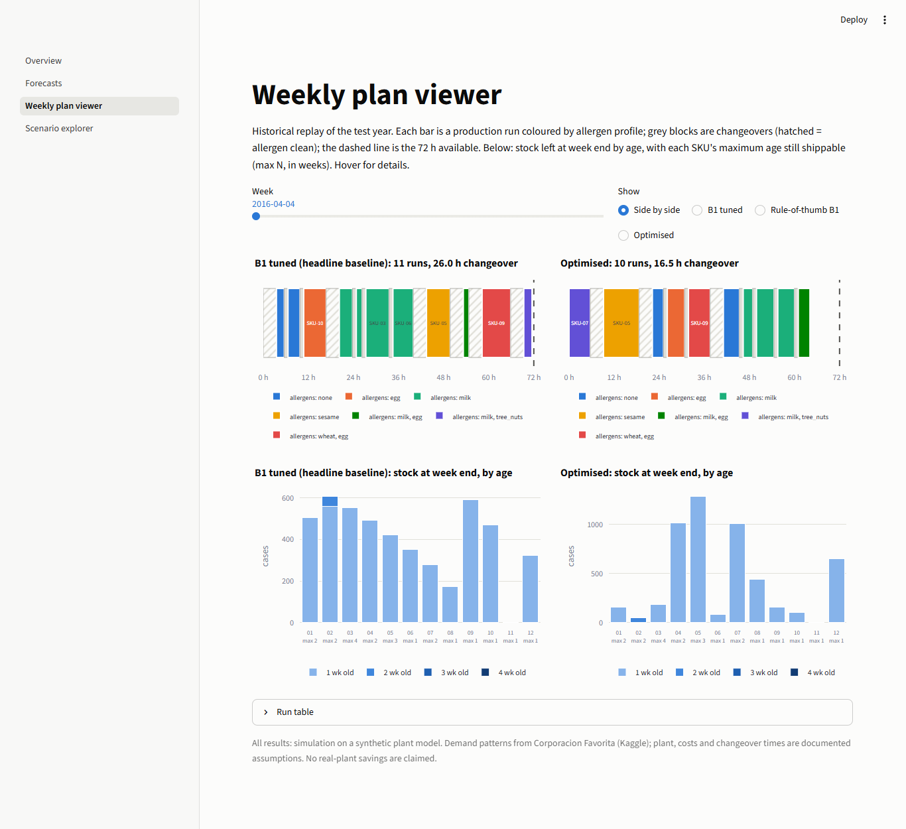
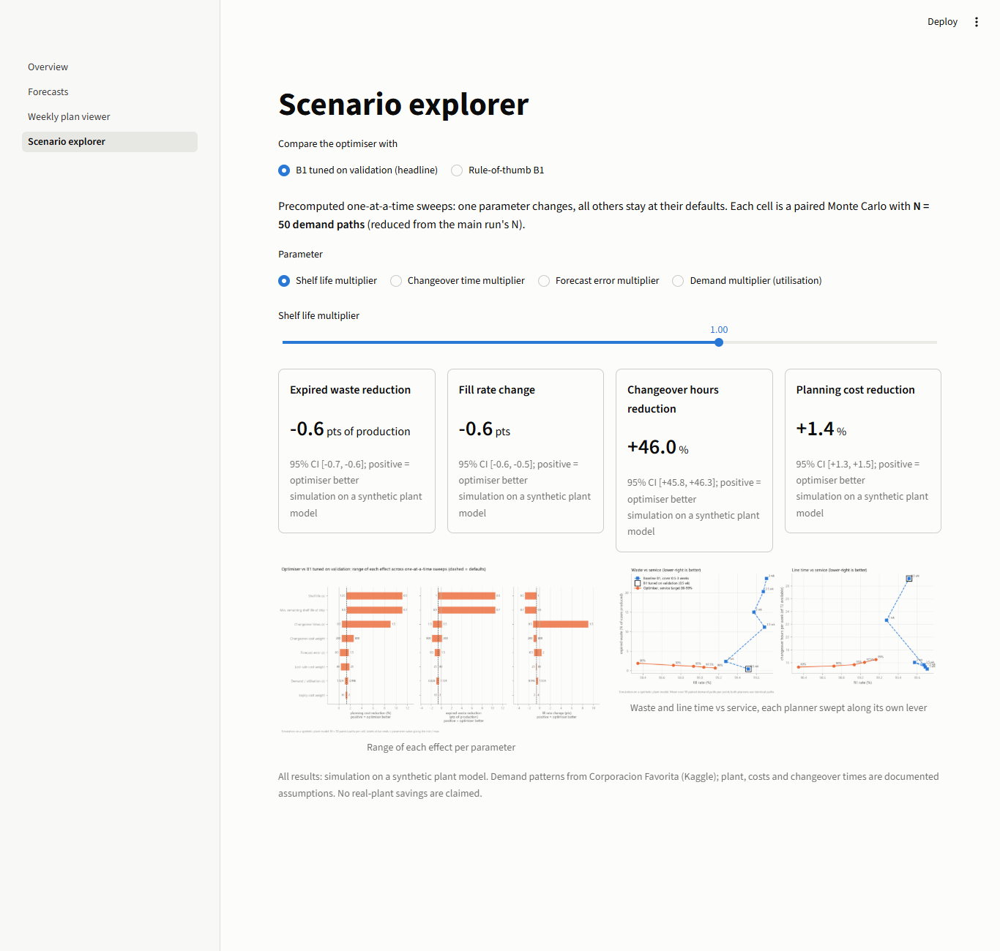

# Dashboard guide

The dashboard reads only small committed files (`results/headline_numbers.json`, `results/app_data/`,
`results/sensitivity/summary.csv`, `results/figures/`). It needs no raw data, no Kaggle token and no solver, so it works
on a fresh clone. It runs locally only; it is not hosted.

## Launch (3 lines)
```
python -m venv .venv && .venv\Scripts\activate        # macOS/Linux: source .venv/bin/activate
pip install -r requirements.txt
streamlit run app/streamlit_app.py
```

## Pages
| Page | What it shows |
|---|---|
| Overview | Headline KPI cards (estimate, 95% CI, label) read verbatim from `headline_numbers.json`; expired waste and fill rate by SKU; week-by-week expired cases and changeover hours (historical replay) |
| Forecasts | Test-year demand vs one-week-ahead forecast with an 80% band per SKU; pooled accuracy of every model |
| Weekly plan viewer | For any test-year week, baseline and optimised side by side: line sequence (Gantt, coloured by allergen profile, hatched allergen cleans, hover for SKU, cases, allergens, changeover hours and clean type) and stock at week end by age against each SKU's maximum shippable age |
| Scenario explorer | Look up the precomputed one-at-a-time sensitivity grid (shelf life, changeover time, forecast error, demand level); values between grid points snap to the nearest point, with a note; tornado and frontier charts |

## Screenshots (1366 px wide, `python scripts/screenshot_app.py` with the app running on port 8599)




## Rebuilding the app data
`python scripts/build_app_data.py` re-runs the test-year replay for both planners and rewrites `results/app_data/`
(about 1 MB, checked to stay under 20 MB by `tests/test_app.py`). Weekly demand is deliberately not exported as a
table (Favorita redistribution terms); the forecast page shows rendered charts instead.
