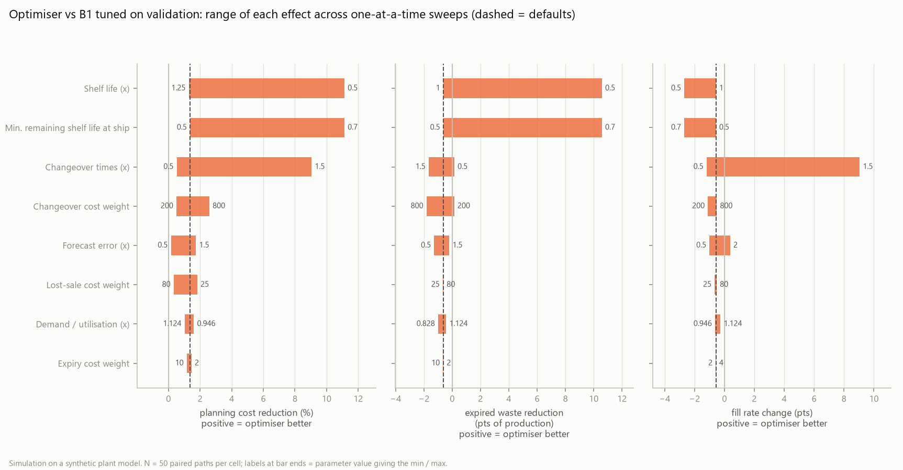
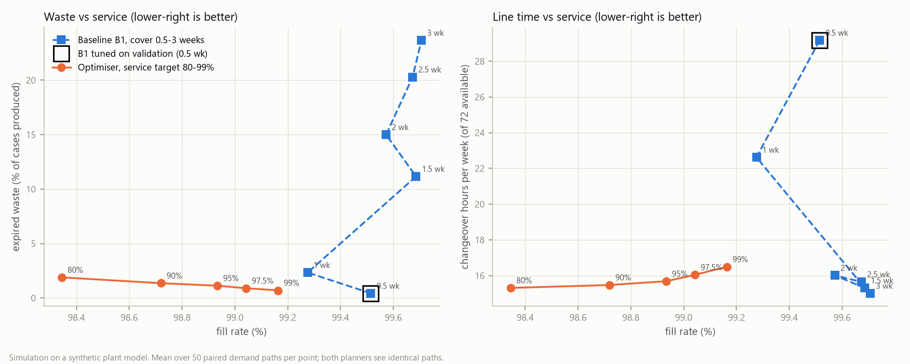

# Sensitivity findings (T5.2.2)

All results: **simulation on a synthetic plant model**. Design and grid: [docs/methods/sensitivity.md](../methods/sensitivity.md).
Every number below comes from [results/sensitivity/summary.csv](../../results/sensitivity/summary.csv) (cell
effects with 95% bootstrap CIs, N = 50 paired paths per cell) or
[results/sensitivity/frontier_points.csv](../../results/sensitivity/frontier_points.csv). Unless a section says otherwise, the
comparison is **optimiser vs the validation-tuned B1** (the headline baseline, ADR-009). The same table also holds
every cell against the rule-of-thumb B1 (`base == "B1"`).

Signs: planning cost and waste are reported as **reductions**, so positive means the optimiser is better. Waste is
in percentage points of cases produced. Fill rate change is in points.

## Summary
- **The optimiser's planning cost was lower in all 29 cells** (CI above zero every time), by 0.16% to 11.1%. This
  is partly by construction: the cost uses the weights the optimiser minimises, and B1 does not see them. It is a
  consistency check, not independent evidence of value.
- **Changeover hours were lower in all 29 cells**, by 21% to 52%.
- **The tuned B1 had lower expired waste in 24 of 29 cells**, and fill rate was non-inferior (at -0.5 pts) in only
  5 of 29. The headline trade-off (line time for waste and service) holds across the grid. It reverses only where
  shelf life is short or the line is short of hours.

## Shelf life
The largest effect on the grid. At shelf life x0.5 the tuned B1 expires **14.4%** of production against the
optimiser's **3.8%**, a gap of 10.6 pts (CI 10.5 to 10.7). Planning cost is 11.1% lower for the optimiser, at a fill
cost of 2.7 pts. At x0.75 the gap is 9.2 pts (12.4% vs 3.2%). At x1.25 the results are within 0.1 pts of the
default, because few SKUs gain a whole shippable week.

Why: B1 orders up to a cover target in weeks of demand and does not look at age. When product only has one or two
shippable weeks, that cover expires. The optimiser plans with an age-indexed inventory, so it makes smaller,
later batches. **This is where a shelf-life-aware optimiser earns its name.** x0.5 puts the 14-day SKUs at 7 days,
outside the 14-56 d design range, so treat it as a stress test. x0.75 is inside the range and shows the same
pattern.

## Minimum remaining shelf life at shipment
MSL 70% gives **the same results as shelf life x0.5, to the last digit**. That is the weekly-bucket caveat, not a
coincidence. Both settings leave every SKU with the same number of shippable weeks, so the model sees the same plant.
MSL 30% narrows the waste gap to -0.46 pts (the optimiser is still worse) and gives a 1.5% cost advantage. The
practical reading is that a customer who demands fresher product (O-04 suggests 60-75% at receipt) moves the plant
toward the regime where the optimiser wins on waste.

## Changeover times
The second regime where the result reverses. At **x1.5 the tuned B1's fill rate falls to 90%, and at x2 to 77%**.
Making every SKU every week no longer fits in 72 hours, and the capacity repair (ADR-010) has to defer whole runs.
The optimiser holds **99% at x1.5 and 83% at x2** (fill +9.1 pts, CI 8.9 to 9.2, and +5.2 pts, CI 4.3 to 6.2). At x2 the line is
overloaded for every planner. At x0.5 cleaning is cheap enough that the optimiser's advantage shrinks to a 0.5%
cost saving, with 0.15 pts *less* waste but 1.2 pts lower fill.

The rule-of-thumb B1 shows the same failure (fill 92% at x1.5, 79% at x2). So the reversal is about any
make-everything-often rule, not about the tuning.

## Forecast error
Error scales both the simulated noise and the optimiser's sigma. With **half the error, the optimiser's cost
advantage is the smallest on the grid (0.16%, CI lower bound 0.09%)**, and its waste is 1.27 pts higher. A tuned
simple rule loses little when demand is predictable. As error grows, the tuned B1's waste rises from 0.40% to 1.07%
of production. At x2 the optimiser's fill is better (+0.39 pts) and its cost advantage is 1.7%. Its 13-week view and
explicit safety stock help most when demand is noisy.

## Demand level (utilisation)
Moving demand from about 70% to about 95% B1 utilisation barely changes the comparison: cost advantage 1.0-1.6%,
changeover reduction 44-49%. At the highest load (x1.124) the waste gap narrows (-0.43 pts) and the fill gap halves
(-0.27 pts), because the tuned B1 also runs out of hours to make every SKU every week. Load matters less than the
changeover multiplier because demand changes run length, not the number of cleans.

## Cost weights
- **Changeover weight** is the lever with the clearest effect on the optimiser's behaviour. At 200/h it cleans more,
  and beats the tuned B1 on waste (+0.14 pts) at a 1.1 pt fill cost. At 800/h it saves 52% of changeover hours and
  expires 1.8 pts more.
- **Expiry weight** (2/4/10 per case) hardly moves anything: the waste gap stays at -0.62 to -0.64 pts. The optimiser's
  waste is set by how often it runs each SKU, which the changeover weight and shelf life drive, not by the expiry
  penalty. This is a finding about the model's structure, worth knowing before anyone "tunes the waste weight".
- **Lost-sale weight** at 80 per case cuts the cost advantage to 0.33% (CI lower bound 0.18%). At that price B1's
  higher fill rate is worth nearly as much as the optimiser's saved hours.

## Waste-vs-service frontier

Each planner is swept along its own service lever (B1 cover 0.5-3 weeks; optimiser service target alpha 80-99%).
- **No optimiser setting reaches the tuned B1's point**: tuned B1 has fill 99.5%, 0.42% expired, 29.2 changeover
  h/week. The optimiser at alpha 99% has 99.2%, 0.70%, 16.5 h/week. The optimiser's frontier is flat in line time
  (15.3-16.5 h/week across all alphas). B1 buys its waste and service with about 13 extra hours a week.
- **B1's cover is a steep lever.** Raising it from 0.5 to 3 weeks takes waste from 0.42% to 23.7% while fill only
  rises to 99.7%. The rule-of-thumb setting (1 week) sits at 2.3% waste. This is why tuning B1 (ADR-009) mattered so
  much.
- On the model's cost weights, alpha 99% is the cheapest point (cost index 100), slightly ahead of the default
  95% (100.5) and the tuned B1 (101.6). **The default alpha was not changed**: picking it from this test-year sweep
  would be test-set tuning. A plant adopting the optimiser should choose alpha on its own validation data.

## Where the optimiser does NOT help
With the default or a longer shelf life, a line with spare hours and moderate forecast error, **a simple
order-up-to rule tuned on one year of history beats the optimiser on both expired waste and fill rate**. That covers
24 of 29 cells on waste, and all but 5 on fill. The optimiser's gains there are line time (about 13 h a week) and
a planning cost that is small and partly circular. A plant that is not short of hours and runs long-life products
should tune its rule before buying an optimiser. The optimiser is worth it where shelf life is short (customer
MSL is high, or products are fresh) or where changeovers are long relative to the line's free hours.

## Numerical robustness
The independent checker found 2 optimiser plans in the earlier sensitivity run (counted once per baseline, so 4)
containing a 0-hour run left by solver round-off. The rolling driver now discards such noise
(`sequence_and_repair`, `tests/test_rolling.py::test_solver_noise_runs_are_dropped`), and **every result was re-run
on the fixed code**. The checker now reports 0 violations in every cell and in the main experiment.

A rolling-horizon plan carries every small difference forward, so many individual optimiser paths changed. The
aggregates did not:

| Measure (58 cell x baseline rows) | Largest absolute change | Median change |
|---|---|---|
| Planning cost reduction (%) | 0.04 | 0.008 |
| Expired waste (pts) | 0.02 | 0.004 |
| Fill rate (pts) | 0.02 | 0.009 |
| Changeover hours reduction (%) | 0.23 | 0.06 |

In the main experiment (N = 200) the largest headline change was the expired-waste comparison against the tuned B1
(-119.3% to -119.9%, inside both CIs). Every other KPI moved by 0.4 points or less. Pre-fix outputs are kept in
`results/superseded/` (`headline_pre_noisefix.json`, `sensitivity_summary_pre_noisefix.csv`). The conclusions do
not depend on solver noise.
