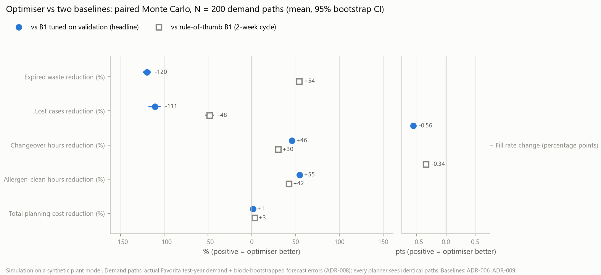
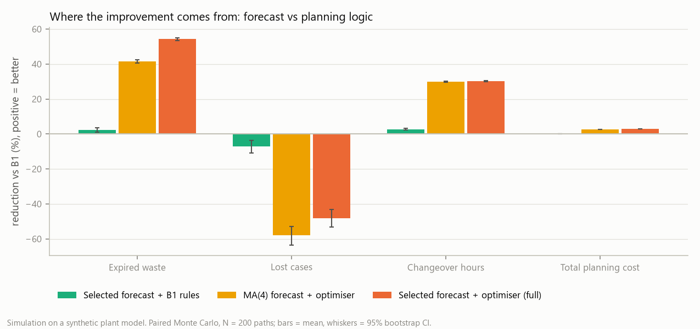

# Results summary

All results: **simulation on a synthetic plant model** driven by real Favorita demand. Numbers in the blocks below
are rendered from [results/headline_numbers.json](../../results/headline_numbers.json) by
`scripts/render_results.py` (a test fails if they go stale). Method: [docs/methods/experiments.md](../methods/experiments.md).

## Two baselines, and why
The optimiser's one free setting was chosen on the validation year (ADR-007). For a fair fight, B1's one free
setting (its cover) was then chosen on the same year with the same rule (ADR-009). The tuned B1 holds half a week
of cover on top of the reorder point, so it makes almost every SKU almost every week. The **headline baseline is
this tuned B1**. The rule-of-thumb B1 (ADR-006, a two-week cycle per SKU, which is how a planner avoids cleaning
for all 12 SKUs every week) stays in as a second reference, because it is the more common practice.

<!-- RESULTS:START -->
| KPI, optimiser vs baseline | Monte Carlo vs B1 tuned on validation (cover 0.5 wk), N = 200 | Monte Carlo vs rule-of-thumb B1 (2-week cycle), N = 200 | Historical replay, test year, same baseline |
|---|---|---|---|
| Expired waste | 119.8% higher (95% CI 115.6 to 124.2) | 54.2% lower (95% CI 53.5 to 55.0) | 100.7% higher |
| Lost cases | 110.8% higher (95% CI 103.9 to 118.1) | 48.1% higher (95% CI 43.2 to 53.3) | 117.8% higher |
| Fill rate | -0.56 (95% CI -0.58 to -0.53) pts | -0.34 (95% CI -0.37 to -0.32) pts | -0.39 pts |
| Changeover hours | 46.0% lower (95% CI 45.8 to 46.1) | 30.2% lower (95% CI 29.9 to 30.5) | 48.2% lower |
| Allergen-clean hours | 54.8% lower (95% CI 54.6 to 55.0) | 42.3% lower (95% CI 42.0 to 42.6) | - |
| Total planning cost (model weights) | 1.4% lower (95% CI 1.3 to 1.4) | 3.0% lower (95% CI 3.0 to 3.1) | 2.1% lower |

Levels (Monte Carlo means): **optimiser** fill 98.9%, expired 1.11% of production, 15.7 changeover h/week, line utilisation 73%; **tuned B1** fill 99.5%, expired 0.50% of production, 29.1 changeover h/week, line utilisation 91%; **rule-of-thumb B1** fill 99.3%, expired 2.37% of production, 22.5 changeover h/week, line utilisation 83%.

Forecast accuracy, test year (WAPE): selected model 11.50% vs 4-week moving average 11.48% (relative change -0.2 (95% CI -5.4 to +4.5)%: no detectable gain); vs seasonal naive 17.60%: 34.7% lower (95% CI 30.8 to 38.3).

Sensitivity (29 one-at-a-time cells, N = 50 each, vs tuned B1): planning cost lower with CI above zero in 100% of cells (range 0.2% lower to 11.1% lower); changeover hours lower in 100%; expired waste lower in 17%.

Independent plan checker: 0 violations; solver fallbacks: 0 weeks. Run `main_33e3602840`, seed 20261118. *All figures: simulation on a synthetic plant model.*
<!-- RESULTS:END -->

## What the numbers say
- **Against the tuned baseline the optimiser trades waste and service for line time.** The tuned B1 keeps stock
  young by running nearly every SKU every week. That gives it the lowest expired waste and the highest fill rate of
  any planner tested, at the price of the most changeover and allergen-clean hours and a line that runs close to
  full. The optimiser makes fewer, larger, better-ordered runs. It frees roughly half of the changeover time and
  more than half of the allergen-clean time, but it expires about twice as many cases and loses more sales. On the
  model's own cost weights it is cheaper overall, by a small margin with a tight CI.
- **Against the rule-of-thumb baseline it wins on waste and line time together**, at a small fill-rate cost. That
  is the comparison most "optimiser vs spreadsheet" case studies make. Here it holds only because that baseline was
  not tuned.
- **Effect sizes and CIs are the evidence.** With N = 200 paired paths every Wilcoxon p-value rounds to 0. That
  reflects the chosen N, not the practical size, so it is not used on its own.
- **Replay vs Monte Carlo.** The replay is one real year (no CI). The Monte Carlo adds resampled forecast errors
  to actual demand (ADR-008). Both layers agree on the direction of every KPI.
- **What the freed time is worth depends on the plant.** In this model, spare hours have no value beyond the
  changeover cost weight. In a plant that can sell extra volume, or that loses hours to breakdowns, freeing about
  13 h of a 72 h week would matter more than the waste difference. That is a judgement for the plant, not a
  result of this model.

## Charter targets (set before any result)
<!-- TARGETS:START -->
| Target (charter, set before any result) | Result | Met? |
|---|---|---|
| Forecast WAPE >= 10% better than seasonal naive | 34.7% lower (95% CI 30.8 to 38.3); vs the 4-week moving average (the strong benchmark): -0.2 (95% CI -5.4 to +4.5)% | Met on paper; no gain over the strong benchmark |
| Expired waste >= 25% lower, CI excluding 0 | tuned B1: 119.8% higher (95% CI 115.6 to 124.2); rule-of-thumb B1: 54.2% lower (95% CI 53.5 to 55.0) | tuned: **Missed**; rule-of-thumb: Met |
| Fill rate non-inferior (>= -0.5 pts) | tuned B1: -0.56 (95% CI -0.58 to -0.53) pts; rule-of-thumb B1: -0.34 (95% CI -0.37 to -0.32) pts | tuned: **Missed**; rule-of-thumb: Met |
| Changeover hours >= 20% lower | tuned B1: 46.0% lower (95% CI 45.8 to 46.1); rule-of-thumb B1: 30.2% lower (95% CI 29.9 to 30.5) | tuned: Met; rule-of-thumb: Met |
| 0 violations in executed plans | 0 in the main experiment; 0 across sensitivity cells | Met |
| 80% / 95% forecast intervals within +/-5 pts on the test year | 71.9% / 86.7% | **Missed** |
| 52-week replay < 90 min | 0.4 min | Met |
<!-- TARGETS:END -->

## Where the improvement comes from (ablation, against the rule-of-thumb B1)
[results/ablation.csv](../../results/ablation.csv), 

The ablation asks which part of the optimiser beats a fixed rule, so it uses the rule-of-thumb B1. Most of the
gain is planning logic: with the same 4-week moving-average forecast as B1, the optimiser already removes about
40% of the expired waste and 30% of the changeover hours. B1 given the selected forecast improves waste by only
about 2%. The selected forecasts add a further ~13 points of waste reduction inside the optimiser, even though
their one-week accuracy equals the moving average. The likely reason is that the 13-week plan uses their seasonal
and trend shape.

## Robustness
One-at-a-time sensitivity and the waste-vs-service frontier: [sensitivity_findings.md](sensitivity_findings.md).

## Kept on record: failures that changed the design
1. The first test-year replay, with the planner's default changeover estimate, was worse than B1 on waste (+55%)
   and lost sales (+36%). The fix was chosen on the validation year only (ADR-007).
2. The first Monte Carlo design centred demand paths on the optimiser's own forecast, which flattered it (66%
   waste reduction vs 43% in the real replay). Replaced by the conservative design before reporting (ADR-008).
3. The sensitivity frontier showed B1 had not been tuned while the optimiser had. B1 was tuned on the validation
   year by the same rule (ADR-009). This turned a "half the waste" headline into a trade-off.
4. Doubling changeover times made B1's capacity repair cut every run at once and collapse (8% fill rate). B1 now
   defers the SKUs with the most stock (ADR-010), and every baseline-dependent result was re-run.
5. The independent checker caught 2 optimiser plans (of about 2,000 in the sensitivity grid) containing a
   0-hour run created by solver round-off. The rolling driver now discards such noise. That small change shifted
   many individual optimiser paths (a rolling plan carries every small difference forward), so every result was
   re-run on the fixed code; the before/after comparison is in [sensitivity_findings.md](sensitivity_findings.md#numerical-robustness).
6. The clean-clone check (rebuilding everything from raw data in a fresh environment) re-derived the demand scale
   with the post-ADR-010 baseline and got a 0.6% different plant, which moved the historical replay. The scale is
   now frozen once calibrated and only range-checked (ADR-011), so a clean clone rebuilds the committed plant.
